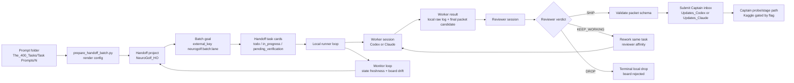

# Current NeuroGolf Handoff Workflow

Created: 2026-07-03

This describes how the local K-NeuroGolf Handoff system is currently used. It is a practical visualization brief, not a secret-bearing runbook.

## Platform Layer

Public Handoff model:

- Base site: `https://handoff.socnet.lol/`
- Human docs: `https://handoff.socnet.lol/docs`
- REST base: `https://handoff.socnet.lol/api/v1`
- MCP endpoint: `https://handoff.socnet.lol/mcp`
- Canonical model: project/request -> goals -> tasks.
- Canonical task statuses: `todo`, `in_progress`, `pending_verification`, `verified`, `rejected`.
- Agents can register, heartbeat, receive messages, claim tasks, submit results, and verify work.
- Handoff supports realtime inbox long-poll, webhook push, tunnel agents, teams, roles, files, E2E encrypted team data, signals, orders, and payment settlement.

NeuroGolf project identity:

- Project name: `NeuroGolf_HO`
- Project id: `82513bd2-0f60-434a-91b2-538d71010fa8`
- Team id: `team_644ac577`
- Owner/admin agent: `boladi_a`
- Testnet only: true
- Preferred settlement network: `base-sepolia`
- Public config: `Handoff/config/public.json`

## Local Runner Layer

The local runner treats Handoff as the board and coordination layer. The actual work happens on this machine through Codex and Claude role sessions.

Main local files:

- `Handoff/runner/prepare_handoff_batch.py` renders a prompt folder into a batch config and creates or reuses Handoff board tasks with stable external keys.
- `Handoff/scripts/Start-HandoffRunner.ps1` starts a worker/reviewer runner loop.
- `Handoff/scripts/Start-HandoffMonitor.ps1` watches local artifacts and optional board drift.
- `Handoff/scripts/Stop-HandoffBatch.ps1` stops runner plus monitor process trees and stamps pid state.
- `Handoff/runner/handoff_runner.py` runs the Codex-style lanes.
- `Handoff/runner/handoff_runner_claude.py` runs the Claude-style lane.
- `Handoff/runner/prompts/` and `Handoff/runner/prompts_claude/` hold role prompts.

Current operating shape:

- Prompt folders under `The_400_Tasks/Task Prompts/<batch>` are the batch input.
- Each batch is represented as a Handoff goal under the shared `NeuroGolf_HO` project.
- Each ARC task gets a Handoff task with an `external_key` like `neurogolf:batch44:codex:task134`.
- The local config stores the Handoff task id and is authoritative for repointing if board ids change.
- Workers produce candidate rewrites.
- Reviewers produce one of three verdict labels: `SHIP`, `KEEP_WORKING`, `DROP`.
- A `SHIP` creates a packet in a Submit Captain inbox.
- The Submit Captain probes/stages/merges packets separately. Kaggle-affecting commands are blocked unless explicitly allowed.

## Role Lanes

### Codex Lane

- Config snapshot: `Handoff/config/runner_codex_p44.json`
- Batch: 44
- Goal external key: `neurogolf:batch44:codex`
- Runner id: `neurogolf:codex:batch44`
- Engine: Codex
- Workers: `bo_ng_worker1`, `bo_ng_cdx_worker2`, `bo_ng_cdx_worker3`
- Reviewers: `bo_ng_reviewer1`, `bo_ng_cdx_reviewer2`
- Submit captain: `bo_ng_submit_captain`
- Captain inbox: `Agenters/Submit_Captain/Updates_Codex`

Monitor snapshot from `Handoff/logs/monitor_codex_batch44.latest.txt` at 2026-07-03T15:01:48Z:

- Runner alive: true
- Counts: `drop=3`, `review_running=2`, `ship_packeted=1`, `todo=11`, `worker_running=3`
- Board/local drift detected.
- Drift examples included local `review_running` mapped to board `pending_verification`, and local `worker_running` still appearing as board `todo`.

### Codex2 Lane

- Config snapshot: `Handoff/config/runner_codex2_p45.json`
- Batch: 45
- Goal external key: `neurogolf:batch45:codex2`
- Runner id: `neurogolf:codex2:batch45`
- Engine: Codex
- Workers: `bo_ng_cdx2_worker1`, `bo_ng_cdx2_worker2`, `bo_ng_cdx2_worker3`
- Reviewers: `bo_ng_cdx2_reviewer1`, `bo_ng_cdx2_reviewer2`
- Submit captain: `bo_ng_cdx2_submit_captain`
- Captain inbox: `Agenters/Submit_Captain/Updates_Codex`

Monitor snapshot from `Handoff/logs/monitor_codex2_batch45.latest.txt` at 2026-07-03T15:05:43Z:

- Runner alive: true
- Counts: `drop=3`, `review_running=1`, `todo=12`, `worker_running=3`
- Board/local drift detected.
- Drift examples included local `review_running` mapped to board `pending_verification`, and local `worker_running` still appearing as board `todo`.

### Claude Lane

- Config snapshot: `Handoff/config/runner_claude_p46.json`
- Batch: 46
- Goal external key: `neurogolf:batch46:claude`
- Runner id: `neurogolf:claude:batch46`
- Engine: Claude
- Workers: `bo_ng_cld_worker1`, `bo_ng_cld_worker2`, `bo_ng_cld_worker3`
- Reviewers: `bo_ng_cld_reviewer1`, `bo_ng_cld_reviewer2`
- Submit captain: `bo_ng_cld_submit_captain`
- Captain inbox: `Agenters/Submit_Captain/Updates_Claude`
- Claude has extra dirs: `K-NeuroGolf-OnnxlyFans` and `Q:/AIz/BoBrain`.

Monitor snapshot from `Handoff/logs/monitor_claude_batch46.latest.txt` at 2026-07-03T15:22:02Z:

- Runner alive: true
- Counts: `todo=5`, `worker_running=1`
- Recent reviewed outcomes included several `DROP` and several `SHIP` packets.

## Current State Machine

Local runner states are richer than the Handoff board statuses.

Approximate mapping:

| Local runner state | Handoff board status | Meaning |
|---|---|---|
| `todo` | `todo` | Candidate task exists but no local role is running. |
| `worker_running` | `in_progress` | A worker session is actively working. |
| `pending_review` | `pending_verification` | Worker submitted output; reviewer should check it. |
| `review_running` | `pending_verification` or `in_progress` | Reviewer is checking the worker packet, but the board cannot cleanly show this substate. |
| `worker_rework` | `in_progress` | Reviewer requested revision. |
| `ship_packeted` | `verified` or locally terminal | Reviewer said SHIP and a packet was written to a captain inbox. |
| `drop` | `rejected` | Reviewer said DROP. |
| `worker_failed`, `review_failed`, `review_parse_failed`, `wall_budget_exhausted` | usually terminal local state | Failure/timeout states may not map neatly to Handoff. |

Important mismatch:

- Public Handoff does not have `pending_review`; its submitted state is `pending_verification`.
- Reviewer verdict labels are local workflow terms. Handoff persists only the canonical task statuses.
- This causes board/local drift visuals unless review substates are represented as metadata, child tasks, or a separate local overlay.

## Current Flow Diagram

## Current Pain Points to Visualize

- Three similar lanes operate at once, but the Handoff board is shared and only partly expresses local substates.
- `worker_running` and `review_running` can drift from board statuses.
- Board status `pending_verification` is overloaded: it can mean "worker submitted, waiting for reviewer" or "review is underway."
- Some status transitions require assigned agent credentials, not just the owner token.
- Direct `GET /api/v1/tasks/:id` has historically returned the SPA/404; reliable reads use project task listing and external key resolution.
- Long-running workers can consume hours if not capped.
- Worker/reviewer failures need robust retry and full process-tree cleanup.
- Pid files historically became stale or lane-global instead of lane plus batch scoped.
- Monitor and runner closeout can leave manual cleanup if not fully automated.
- Batches can waste spend re-solving already-owned floors, duplicate candidates, or known wall tasks.
- Packets must include enough provenance: batch id, runner id, Handoff task id, external key, goal id, worker id, reviewer id, and created time.
- Raw transcripts are private, so public/visual dashboards should summarize evidence without exposing raw logs.

