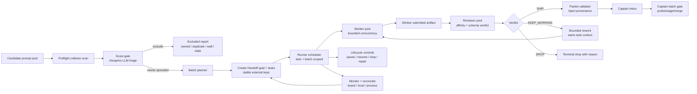

# Optimized Handoff Workflow Brief

Created: 2026-07-03

This is a design target for visualizing a cleaner Handoff workflow for K-NeuroGolf. It combines the public Handoff lifecycle with local runner lessons from recent batches.

## Design Goal

Make the system feel like a controlled production line:

1. Choose better work before creating or launching tasks.
2. Make each task state unambiguous.
3. Keep board truth, local process truth, and artifact truth aligned.
4. Stop expensive tails automatically.
5. Move only reviewer-approved packets into Submit Captain.
6. Make every manual intervention visible and reversible.

## Target Workflow

## Core Improvements

### 1. Preflight before board creation

Before creating Handoff tasks:

- Scan live manifest, staged outputs, consumed packets, previous runner reports, task claims, and existing board cards.
- Exclude tasks already owned at/near floor.
- Exclude byte-identical duplicate candidates.
- Exclude recent hard-wall tasks unless explicitly reopened.
- Emit `excluded_by_reason.csv` or equivalent.
- Create board cards only for tasks that should really run.

Visualization idea:

- Show a funnel from "candidate prompts" to "approved batch tasks."
- Annotate how many are excluded for each reason.

### 2. Scout gate before expensive workers

Add a cheap/no-LLM scout pass:

- Input: task prompt, live manifest row, task history, known floors/walls, staged/consumed history.
- Output: `park_wall`, `park_owned`, or `needs_specialist(levers[])`.
- Only `needs_specialist` tasks reach the expensive Codex/Claude workers.

Visualization idea:

- Make the scout gate a small decision diamond before the worker pool.
- Show "cheap filter" as reducing token/time burn.

### 3. Clear state model

Use Handoff canonical statuses for public board state:

- `todo`
- `in_progress`
- `pending_verification`
- `verified`
- `rejected`

Represent local runner substates separately:

- As task metadata/tags, child nodes/subtasks, or a local dashboard overlay.
- Suggested substates: `scouted`, `worker_running`, `worker_submitted`, `review_queued`, `review_running`, `rework_queued`, `packet_validated`, `captain_queued`, `captain_probed`, `terminal_drop`, `terminal_ship`.

Best design option:

- Use one visible Handoff task per ARC task for the board.
- Use child nodes or an expanded detail panel for worker/reviewer/captain substages.
- Keep the Handoff status simple; keep the richer lifecycle in the task detail.

### 4. Lane and batch scoped runtime truth

Every runtime artifact should include lane and batch:

- Runner pid file: lane + batch scoped.
- Monitor pid file: lane + batch scoped.
- Runner state: lane + batch scoped.
- Closeout note: lane + batch scoped.
- Packet metadata: lane, batch, runner id, task id, external key, goal id, worker id, reviewer id, created time.

Visualization idea:

- Use swimlanes for `Codex`, `Codex2`, and `Claude`.
- Each swimlane has its own runner, monitor, state file, and captain inbox connection.

### 5. Bounded work and automatic stop conditions

Add task budgets:

- `max_task_sessions`
- `max_task_wallclock_minutes`
- existing `worker_max_failures`
- existing `reviewer_max_failures`
- existing `max_rework_cycles`
- role-aware timeouts

Terminal outcomes should include:

- `ship_packeted`
- `drop`
- `worker_failed`
- `review_failed`
- `review_parse_failed`
- `wall_budget_exhausted`

Visualization idea:

- Show "budget guard" around each task loop.
- Put timeout/failure exits into a terminal lane instead of looping invisibly.

### 6. Reconciliation as a first-class loop

The monitor should compare:

- Board state from Handoff project task listing.
- Local state from runner state JSON.
- Process state from pid/process tree.
- Artifact state from raw/final logs and captain packets.

Automated repair actions should be explicit:

- `Pause-HandoffBatch`
- `Resume-HandoffBatch`
- `Stop-HandoffBatch`
- `Stop-HandoffTask`
- `Repair-HandoffTask`
- `Repair-HandoffBoard`
- `Test-HandoffProcessTree`

Visualization idea:

- Add a "truth reconciliation" ring around the workflow.
- Use alert badges: `drift`, `stale pid`, `orphan process`, `sync miss`, `manual review`.

### 7. Event-driven Handoff integration

The public Handoff platform supports:

- Long-poll inbox: `GET /api/v1/agents/:id/inbox?wait=25&since=N`.
- Webhook push.
- Tunnel agents for public endpoints.
- `handoff-wait.mjs` listener loop.
- Heartbeats and explicit offline.
- Signals: `PAUSE`, `RESUME`, `STEER`, `ABORT`, `REASSIGN`.
- Orders through project hierarchy.

Optimized local workflow should move toward:

- Event-driven task assignment and status update where possible.
- Less reliance on repeated blind polling.
- Explicit stop/offline semantics so "online" means there is a real worker behind it.

Visualization idea:

- Show Handoff as the realtime coordination backbone, with local runners subscribing rather than manually checking everything.

## Optimized Diagram Objects

Use these as nodes in a design visualization:

- Candidate prompt pool
- Preflight collision scanner
- Scout gate
- Excluded report
- Batch planner
- Handoff project
- Batch goal
- Handoff task card
- Runner scheduler
- Worker pool
- Reviewer pool
- Packet validator
- Submit Captain inbox
- Captain probe/stage gate
- Monitor
- Board reconciler
- Process tree auditor
- Stop/pause/resume/repair controls
- Closeout report

Use these as edge labels:

- create/reuse task
- claim
- submit result
- request review
- SHIP
- KEEP_WORKING
- DROP
- validate packet
- enqueue packet
- probe batch
- drift detected
- repair/repoint
- close batch

## Current vs Optimized Contrast

| Area | Current | Optimized |
|---|---|---|
| Work selection | Prompt folder becomes board tasks, with some preflight now emerging. | Collision scan and scout gate before board task creation. |
| Board state | Handoff statuses plus local runner substates can drift. | Canonical board statuses plus explicit substate overlay/children. |
| Runtime identity | Multiple lanes share project; some pid/state naming historically lane-global. | Every pid/state/closeout artifact scoped by lane and batch. |
| Expensive workers | Workers can spend long sessions on wall tasks. | Per-task session and wall-clock budgets. |
| Review | Reviewer verdict is local; Handoff sees pending/verified/rejected. | Reviewer phase shown as subtask/detail; verdict schema validated. |
| Packet handoff | Reviewer-approved packets go to captain inbox; metadata sometimes needs hardening. | Packet validator injects complete provenance before captain queue. |
| Monitoring | Monitor catches stale state and board drift. | Monitor plus reconciler exposes repair actions and closeout state. |
| Manual operations | Stop/repair sometimes manual and after-the-fact. | Pause/resume/stop/repair are visible lifecycle tools. |

## What a Good Final Visual Should Communicate

- Handoff is the shared public coordination board.
- The local runner is the execution engine.
- Worker/reviewer/captain are separate roles, not one monolithic agent.
- The optimized workflow filters earlier, spends less, and tells the truth better.
- Board state, process state, and artifact state are different signals that must be reconciled.
- Testnet and safety gates are intentional parts of the workflow.

