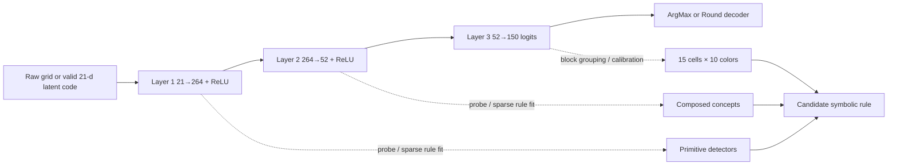

# Extracting symbolic rules from small trained MLPs

## Executive summary

This note follows the user-supplied research card specification and treats missing operational details as unspecified rather than invented. In particular, the card specifies a small trained MLP setting, an example shape such as `21 → 264 → 52 → 150`, discrete grid-style inputs and outputs, and a desire for an explicit symbolic rule in a fixed operation vocabulary, without an inference-time LLM.

For the specific problem class in the card, the cheapest *published* family of approaches is usually **pedagogical rule extraction by querying the trained MLP and distilling it into a small decision tree or rule list**, optionally using TREPAN-style query synthesis or soft-tree distillation. These methods are easy to implement with standard tooling, work well when arbitrary teacher queries are cheap, and directly output symbolic objects that can often be compiled into a fixed operator vocabulary. Their main weakness is that they optimize **fidelity by approximation**, not exact equivalence.

If exactness matters, the strongest family is **piecewise-linear analysis of ReLU networks**, especially OpenBox-style exact interpretation for piecewise-linear neural networks and verifier-backed reasoning with Marabou, ReLUplex, or MILP encodings. ReLU MLPs compute piecewise-linear or piecewise-affine functions over activation regions, so in principle one can express network behavior as a partition of the input space into polytopes with affine output rules. In practice, this is excellent for proving or refuting candidate rules and extracting exact *local* rules, but often expensive for producing one short global symbolic program.

Pure attribution methods such as **LIME, Anchors, and SHAP** are useful support tools but are rarely sufficient by themselves for global rule recovery. LIME fits local surrogate models, Anchors returns local if-then clauses with precision guarantees, and SHAP returns additive feature attributions. These are valuable for naming features, stress-testing hypotheses, and guiding probe construction, but they do not natively return a faithful global symbolic rule for a whole MLP.

For a **small ReLU MLP with discrete categorical outputs**, the problem is substantially more tractable than generic “deep interpretability.” On each fixed ReLU activation pattern, the network reduces to an affine map; then argmax or rounding partitions that affine region into linear inequality cells. This means candidate rules can be represented as trees, rule lists, or polyhedral clauses. The two hidden layers also make a practical two-stage workflow possible: infer `input → hidden_1` primitive semantics, then `hidden_1 → hidden_2 → output` composition and decoding. That is a synthesis from decompositional rule extraction, probing, and PLNN theory rather than a theorem proved specifically for the 30×30-grid / 21-dimensional compressed-latent case.

The strongest practical recommendation is therefore a **hybrid workflow**: first, build interpretable probes for hidden units and decoder blocks; second, distill the teacher into a compact tree or rule list on valid synthetic queries; third, use Marabou or MILP to search for counterexamples separating the extracted rule from the MLP; and only if fidelity remains poor, escalate to OpenBox- or ECLAIRE-style exact/decompositional extraction. This gives the best cost-to-faithfulness tradeoff for the problem described in the card.

## Inventory of techniques

The rule-extraction literature still largely organizes methods into **pedagogical** approaches that treat the network as a black box, **decompositional** approaches that exploit internal structure layer by layer, and **eclectic** approaches that mix both. That taxonomy originates in classic surveys and is still used in recent reviews. A recurring theme across the literature is the tradeoff between **fidelity**, **accuracy**, and **comprehensibility**: the most exact methods are usually the least concise, while the most concise methods are usually approximate.

| Technique | Reference | Output type | Sample complexity | Code/tool available | Applicability to small discrete-output MLP |
|---|---|---|---|---|---|
| TREPAN / query-induced decision tree extraction | Craven & Shavlik 1995; later TREPAN case study  | Global decision tree | Moderate to high query budget; specifically benefits from teacher queries outside the training set because it “uses queries to induce a decision tree.”  | Unofficial Python implementations exist.  | **High** if arbitrary valid teacher queries are available and the desired rule can be tree-like. |
| Soft decision tree distillation | Frosst & Hinton 2017  | Soft or hardenable decision tree | Moderate; needs a distillation set, often thousands of teacher-labeled samples or logits.  | Community PyTorch implementations exist.  | **Medium to high** for a first symbolic approximation, but soft splits still need hardening for fixed-op deployment. |
| LIME | Ribeiro et al. 2016  | Local sparse linear surrogate | High per explained point; common implementation default is `num_samples=5000`.  | Official repo and docs.  | **Low as a standalone extractor**, **useful as support** for discovering which latent directions matter locally. |
| Anchors | Ribeiro et al. 2018  | Local if-then rules with precision guarantee | Adaptive and potentially high; multi-armed-bandit search continues until a precision threshold is met.  | Official repo.  | **Medium** for extracting local clauses around specific examples or regions; **low** for whole-network global recovery by itself. |
| SHAP / KernelSHAP | Lundberg & Lee 2017  | Local additive feature attributions | Exact model-agnostic Shapley is exponential, `O(2^M)`; sample-based explainers use approximation, and common auto settings use `nsamples ≈ 2M + 2048`.  | Official repo and docs.  | **Low as a final rule extractor**, **good** for ranking latent features and checking whether a surrogate ignored important directions. |
| DeepRED / layerwise decompositional extraction | Zilke et al. 2016  | Rule set / rule tree extracted layerwise | Can become expensive with depth and data volume; original work improved on shallow-only methods but still suffers scaling issues.  | Available in research packages such as `ruleex`; community repos also exist.  | **High** for small feedforward MLPs when layerwise semantic decomposition is wanted. |
| ECLAIRE / REMIX | Espinosa Zarlenga et al. 2021  | Global rule set | Claimed polynomial-time extraction and better scaling than DeepRED/REM-D.  | Official REMIX library.  | **High** when the model is still feedforward but larger, or when DeepRED-style layerwise extraction becomes clumsy. |
| OpenBox exact PLNN interpretation | Chu et al. 2018  | Equivalent local linear classifiers / exact piecewise explanation | No stochastic neighborhood sampling required, but region complexity can still grow.  | Official code repo.  | **Very high** for ReLU MLPs when exact local linear semantics matter more than short global summaries. |
| ReLUplex / Marabou / MILP verification | Katz et al. 2017; Marabou 2019 and 2024; Tjeng et al. 2019  | SAT/UNSAT certificates, counterexamples, feasible region witnesses | Not sample-driven; complexity is solver/search complexity over piecewise-linear constraints.  | Official repo, docs, and tools.  | **Very high for validation and exact region testing**, **moderate** for full global extraction because enumeration can explode. |
| TabNet-style attentive interpretability | Arik & Pfister 2021  | Instancewise masks and global feature importances | Retraining cost roughly comparable to training a new tabular model.  | Official paper and maintained implementation.  | **Low as a post-hoc extractor for an existing vanilla MLP**; **useful as a surrogate baseline** if retraining is allowed. |
| Linear probes / TCAV / mechanistic feature analysis | Alain & Bengio 2016; Kim et al. 2018; Olah et al. 2020; Anthropic 2022  | Concept detectors, probe accuracies, feature subspaces | Moderate; requires concept datasets or synthetic labels rather than exhaustive querying.  | Paper code varies; the methodology is easy to reproduce with standard ML tooling.  | **High as a bridge technique** for decoding hidden-layer semantics, but **not sufficient alone** for final global rule extraction. |

The conflict in the literature is not really “which method is best,” but **which objective is primary**. If the objective is a compact symbolic object that behaves like the MLP on most valid inputs, pedagogical distillation is usually best. If the objective is a mathematically exact account of the ReLU network, exact PLNN interpretation plus verification is stronger. If the objective is understanding what hidden units encode, probes and concept methods are more informative. Recent surveys and eclectic methods explicitly frame modern work as attempts to balance those goals rather than to eliminate the tradeoff.

## Small MLPs with discrete outputs

For the card’s main setting, a three-layer MLP with ReLU activations can be written as

\[
h_1 = \mathrm{ReLU}(W_1x+b_1), \quad
h_2 = \mathrm{ReLU}(W_2h_1+b_2), \quad
y = W_3h_2+b_3.
\]

The example architecture in the card, `21 → 264 → 52 → 150`, is still tiny by modern standards and well within the regime where teacher-query distillation, exhaustive activation tracing, and solver-backed counterexample search are all realistic engineering choices.

The key structural fact is that a ReLU network computes a **piecewise-linear** or **continuous piecewise-affine** function. Each fixed active/inactive pattern of the hidden ReLUs defines one linear region, and on that region the network acts like a single affine map. This is the theoretical basis of both region-counting work and exact interpretation methods such as OpenBox, and it is exactly why rule extraction is more plausible for small ReLU MLPs than for arbitrary nonlinear nets.

For a **10-color × 15-cell categorical output**, two common decoders matter. If each cell selects one color by **argmax**, then on any fixed ReLU region the class assignment for a cell is determined by pairwise linear inequalities comparing the chosen logit with the nine alternatives. If the output is instead **rounded** to integers, then each rounded output pattern corresponds to half-open interval constraints on affine coordinates. This means that within each activation region, the final symbolic rule is a conjunction of linear inequalities. That conclusion is an inference from PLNN theory plus the formal semantics of ReLU, ArgMax, and Round; it does **not** imply the global rule will be short.

This polyhedral view is exactly why **Marabou-style reasoning** is relevant. Marabou represents ONNX networks as piecewise-linear constraints, answers SAT/UNSAT queries, and can return a concrete satisfying assignment when a property fails. The Marabou papers also state that termination is guaranteed only for piecewise-linear activations, which aligns well with a small fully connected ReLU MLP. In practice, that makes Marabou more useful for **checking candidate rules and finding counterexamples** than for globally enumerating every region.

The small depth also supports a practical **two-stage extraction** strategy. First, interpret `input → hidden_1` as primitive feature detectors. Second, interpret `hidden_1 → hidden_2 → output` as composition and decoding. That is consistent with decompositional rule extraction, which explicitly extracts rules layer by layer, and with probe methodologies that ask what information is linearly recoverable from each intermediate representation. The literature does not directly benchmark this exact grid-encoder setting, so this recommendation should be read as a technically justified inference rather than a published turnkey recipe.



For **discrete latent codes**, solver-based extraction becomes even more attractive. Marabou’s examples include disjunction constraints, which can be used to encode discrete cases such as “this latent coordinate must be 0 or 1” or small finite-choice structures. If the 21-dimensional input is not arbitrary continuous data but a compact code with combinatorial validity constraints, bringing those constraints into the solver is one of the best ways to avoid learning spurious rules on impossible inputs.

## Input and output encoding decoding

A crucial caveat from the card is that the first and last layers may partly “memorize” unknown encoder/decoder behavior. If the raw 30×30 grid encoder is unavailable, then any recovered symbolic description is identifiable only **up to the latent code actually presented to the MLP**. In other words, one may recover the MLP’s rule over the 21-dimensional latent domain without uniquely recovering the original human-designed encoder unless there is additional calibration data tying latent coordinates back to grid primitives. That caveat matters for every method in this report.

The most defensible way to reverse-engineer the **input encoder** is to treat `hidden_1` as a bank of candidate primitive detectors and use **concept probing**. Build a representative synthetic set of raw inputs or valid latent codes that vary one grid primitive at a time, record `hidden_1` activations, and train simple probes or sparse rule models to predict each neuron’s activation state or activation bin from candidate interpretable features. Linear probes tell you whether a concept is recoverable from a hidden representation, and TCAV-style concept vectors give a way to test whether a chosen human concept aligns with a direction in latent space.

For this specific setting, the cheapest practical procedure is usually: standardize the 21 latent inputs, rank each `hidden_1` neuron’s incoming weights by absolute standardized effect, generate activation-triggering examples near the ReLU threshold, and then fit a **very small** decision stump, sparse logistic regressor, or anchor clause for “neuron `j` is on.” Because the neuron pre-activation is affine in the latent input before ReLU, large standardized coefficients are suggestive; because real networks can be polysemantic, they are not conclusive. Probe fitting and contrastive testing are what make the interpretation credible.

The **output decoder** is usually easier, because the 150 outputs already live close to the symbolic target. If the intended structure is really 15 cells × 10 colors, then either the output order is known or it can often be recovered with a small calibration set by mapping output vectors to known cell-color labels. After that, one can train one-vs-rest probes from `hidden_2` to each cell-color category, or fit sparse trees from `hidden_2` to each cell’s color choice. OpenBox’s perspective is useful here: on each fixed activation region the network is already just a linear classifier over inputs, so the last layer often behaves like a sparse decoder over a handful of hidden concepts.

A practical heuristic for mapping `hidden_2 → output` is to search for **block structure** in the last-layer weights. If outputs are ordered by cell, the last-layer weight matrix often exhibits rows or columns that cluster by cell or by color family. Even when that structure is not obvious by inspection, sparse per-cell probes and mutual-exclusivity checks generally expose it quickly. This is an engineering inference, but it is exactly the kind of layerwise decomposition that decompositional rule extraction methods operationalize.

One strong warning from modern mechanistic work is that **single-neuron explanations can be misleading**. Toy-model studies of sparse-feature learning show that networks can represent more features than dimensions via superposition, producing polysemantic units. In a small MLP, that means several hidden neurons may each mix multiple grid concepts, or a human concept may live in a small subspace rather than a single neuron. When that happens, the right move is to switch from “name the neuron” to “name the sparse set of neurons or direction” and then distill rules on those grouped features.

## Sample complexity

There is no single sample-complexity answer for “how many auxiliary inputs are needed,” because the answer depends on the **hypothesis family of the target symbolic rule**, whether **arbitrary membership queries** are allowed, and whether the goal is **approximate fidelity** or **exact equivalence**. The literature therefore gives useful bounds for target families and query models rather than one universal number.

| Target family | Best cited guidance | Practical implication for this problem |
|---|---|---|
| Depth-`d` decision tree over `n` features | Adaptive exact learning with membership queries can use roughly `Õ(2^(2d)) + 2^d log n` randomized queries for depth-limited trees.  | If the true rule is a shallow tree over interpretable latent or probed features, exact disambiguation can be query-efficient relative to brute force. |
| Linear separator / sparse threshold rule | Under favorable distributional assumptions, active learning can reach error `ε` using about `Õ(d log(1/ε))` labels rather than passive rates that can be much worse.  | If a hidden unit or decoder block behaves like a sparse linear threshold, a few thousand well-chosen probes can be enough. |
| Local additive explanations | Exact Shapley is `O(2^M)` in the number of features `M`; approximate explainers reduce this with sampling. For `M=21`, exact coalition enumeration would mean `2,097,152` coalitions per explanation.  | SHAP is feasible as a diagnostic on a few outputs, but not as the primary route to a full 15-cell symbolic rule. |
| Local perturbation explainers | The common LIME tabular implementation uses `num_samples=5000` by default, and Anchors keeps sampling until a precision guarantee is established.  | LIME and Anchors are practical for a handful of examples or neurons, but expensive to run indiscriminately over many outputs and regions. |
| Black-box teacher extraction | Model-extraction work shows >99% matching on target input space for several model classes, but neural networks can require far more queries than linear equation-solving attacks; ACTIVETHIEF reports useful stolen models with only 10–30% of public samples.  | Query-efficient imitation of a small MLP is realistic, but exact equivalence still depends on the rule family and the validity of queried inputs. |

Two sharper takeaways follow from that table. First, **active querying matters**. Balcan, Hanneke, and Wortman Vaughan show that active learning can provide exponential gains in the limit in settings where passive sampling appears stubbornly expensive. That is directly relevant here because the MLP can serve as a cheap labeling oracle on constructed inputs.

Second, the right “query budget” is almost always much smaller than people fear *if* the extracted rule family is simple. If the final rule is a shallow tree or a small rule list over 21 interpreted features, then tens of thousands of valid teacher queries is already a generous offline budget on commodity hardware. If the network really requires a large number of piecewise-affine regions to explain, no such budget will rescue a short symbolic rule, and the problem shifts from sample complexity to **description complexity**. That is exactly the fidelity-versus-comprehensibility dilemma emphasized in the rule-extraction literature.

For the card’s example dimensionality, a good practical order of operations is: use a few thousand synthetic queries to decode hidden semantics, then 10k–50k valid teacher queries for surrogate distillation, and only then pay solver costs for exact counterexample search. That recommendation is a synthesis of active-learning bounds, query-based extraction results, and the engineering behavior of modern verification tools.

## Practical pipelines with code references

The literature supports three realistic pipelines for this problem class, each with a different cost profile. **Query-distillation** is the cheapest to build, **polytope/exact extraction** is the strongest on faithfulness, and **probe-first extraction** is the best bridge when the major unknown is what the encoder and decoder are doing internally.

| Pipeline | Source | Steps | Output format | Known limitations |
|---|---|---|---|---|
| Distill into a decision tree or rule list | TREPAN; soft-tree distillation; classic pedagogical extraction  | Query the teacher MLP on many **valid** synthetic inputs, fit a shallow tree or rule list, prune for simplicity, then search for counterexamples and refine. | Global decision tree, per-cell rule list, or a fixed-op symbolic program compiled from the tree. | Approximate by default; can learn rules on impossible latent states if synthetic queries leave the true input manifold.  |
| Polytope / exact PLNN extraction | OpenBox; Marabou; MILP verification  | Export to ONNX, analyze local linear regions, encode candidate rule properties as linear constraints, and use exact solving to prove or refute them. | Polytope partition, local linear classifier family, or formally checked region-wise rule clauses. | Region explosion is real; exact local explanations do not automatically compress into a short global symbolic rule.  |
| Probe-network extraction | Linear probes; TCAV; concept-guided distillation  | Dump intermediate activations, train probes for candidate concepts and outputs, group neurons into interpretable concept sets, then distill rules on probe outputs or selected hidden units. | Concept map, sparse neuron sets, and rule lists over hidden concepts or proxy concepts. | Requires a concept library or engineered probes; can miss polysemantic subspaces or nonhuman concepts.  |

The first pipeline is usually the right starting point when the end product must be a **symbolic rule executable without an LLM**. In spirit it is the TREPAN idea updated with modern tooling: use the MLP as a teacher oracle, but only query on valid latent points or raw-grid-derived encodings.

```python
# Query-distillation on valid latent inputs
import numpy as np
from sklearn.tree import DecisionTreeClassifier, export_text

# X_valid_query: shape [n, 21], sampled from the VALID latent manifold
# y_teacher: shape [n, 15], one color index per output cell
y_teacher = teacher_predict_colors(X_valid_query)  # e.g. argmax over 15x10 logits

trees = []
for cell in range(15):
    clf = DecisionTreeClassifier(max_depth=5, min_samples_leaf=25, random_state=0)
    clf.fit(X_valid_query, y_teacher[:, cell])
    trees.append(clf)
    print(f"\nCell {cell}")
    print(export_text(clf, feature_names=feature_names))
```

That snippet is deliberately simple. A published TREPAN-style system would query adaptively and may use richer split tests, but the core idea is the same: treat the MLP as an oracle, train small symbolic surrogates, then refine them with disagreement search.

The second pipeline is the one to use when you already have a candidate rule and want to know whether it is **actually faithful**. OpenBox is attractive because it is designed for piecewise-linear neural networks, while Marabou and MILP tools are attractive because they can search for exact counterexamples in constrained regions.

```python
# Minimal Marabou ONNX query skeleton
from maraboupy import Marabou

net = Marabou.read_onnx("mlp.onnx")
options = Marabou.createOptions(verbosity=0)

input_vars = net.inputVars[0][0]   # batch dim stripped
output_vars = net.outputVars[0]

# candidate_rule_input_box should encode the region where your extracted rule claims to apply
for i, (lo, hi) in enumerate(candidate_rule_input_box):
    net.setLowerBound(input_vars[i], lo)
    net.setUpperBound(input_vars[i], hi)

# Example property: the target output coordinate must remain above a chosen floor.
# For pairwise logit comparisons, add custom equations via MarabouCore.
target = output_vars[target_index]
net.setLowerBound(target, target_floor)

vals, stats = net.solve(options=options)
print("SAT" if vals else "UNSAT")
```

Marabou’s official ONNX example shows the same core operations: load an ONNX model, read input and output variables, set bounds, and call the solver. Its lower-level MarabouCore example shows how to add explicit equations and ReLU constraints when a higher-level ONNX query is not expressive enough.

The third pipeline is especially valuable in the card’s “memorized encoder / decoder” scenario, because the hard part is not immediately “find the whole rule,” but first “discover what the hidden layers mean.” Linear probes are the cheapest reliable starting point, and TCAV-style concept tests are useful if you already have candidate human concepts such as translation, border color, object count, symmetry, or connected-component presence.

```python
# Probe hidden activations, then induce a tiny rule on selected hidden units
import numpy as np
from sklearn.linear_model import LogisticRegression
from sklearn.tree import DecisionTreeClassifier, export_text

H1 = collect_hidden_activations(model, X_probe, layer_name="hidden1")  # [n, 264]
concept = concept_has_red_border.astype(int)                           # engineered labels

probe = LogisticRegression(penalty="l1", solver="liblinear", C=0.1)
probe.fit(H1, concept)

selected = np.flatnonzero(probe.coef_[0])
cell0_tree = DecisionTreeClassifier(max_depth=3, min_samples_leaf=20, random_state=0)
cell0_tree.fit(H1[:, selected], teacher_predict_colors(X_probe)[:, 0])

print("Selected hidden units:", selected.tolist())
print(export_text(cell0_tree))
```

A strong pattern in practice is to run **probe-first, distill-second, verify-third**. Probe-first tells you whether the network has learned clean hidden concepts at all. Distillation then turns those concepts into short rules. Verification finally tells you whether the resulting rule is faithful or just plausible. That ordering tends to minimize wasted solver time.

## Adversarial validation, failure modes, decision guidance, and checklist

**Adversarial validation.** The right standard is not “does the extracted rule look sensible,” but “can one find a valid input where the rule and the MLP disagree?” Formally, if `R(x)` is the extracted rule and `f(x)` is the MLP, then the ideal check is to search the valid domain `D` for any `x` such that `x ∈ D` and `R(x) ≠ f(x)`. If a verifier proves that set is empty on a region, the rule is faithful there. If a solver finds one witness, the rule is wrong or incomplete. This is exactly the use case where Marabou and MILP-style verifiers shine.

**Contrast-set construction.** The most effective contrast sets are usually near the surrogate’s boundaries: examples near tree thresholds, near ReLU switching surfaces, or near output-tie surfaces where two colors compete for the same cell. Active learning suggests querying exactly such uncertain or boundary-adjacent examples, and model-extraction work confirms that carefully selected queries recover target behavior faster than passive sampling. For grid tasks, this usually means perturbing just one hypothesized primitive at a time while preserving all others.

**When extraction is hopeless.** There are three major failure modes. First, the MLP may have memorized idiosyncratic associations with no short symbolic summary, in which case any high-fidelity tree or rule list will become large and unstable. Second, the learned computation may be naturally continuous or geometric rather than expressible in the user’s fixed op vocabulary, so an exact descriptor exists but is not human-compact. Third, the representation may be polysemantic, meaning the relevant concepts are superposed rather than neuron-localized, which defeats simple per-neuron explanations. All three reflect the central tension between fidelity and comprehensibility emphasized in rule-extraction surveys and recent mechanistic-interpretability work.

**Decision guidance.** The table below is the shortest practical answer to “given MLP shape, data, and target rule expressiveness, which technique should be used?”

| Situation | MLP shape | Training data | Recommended technique | Why |
|---|---|---|---|---|
| Small ReLU MLP, shallow rule expected, cheap query access | One or two hidden layers, under ~100k parameters | Visible pairs plus ability to synthesize many valid teacher queries | TREPAN-style decision-tree distillation, then counterexample search  | Lowest engineering cost, directly yields symbolic objects, and query complexity is favorable when the target rule is shallow. |
| Small ReLU MLP, exactness matters more than compactness | Two or three hidden layers, piecewise-linear activations, ONNX export possible | Valid input domain can be bounded or constrained | OpenBox plus Marabou or MILP verification  | Best route to exact local rules and proof-grade counterexamples; strongest faithfulness story. |
| Unknown encoder or decoder is the real bottleneck | Small or medium MLP with hidden layers much wider than input | Some labeled concepts or engineered grid features are available | Probe-network pipeline, then distill on probe outputs  | Cheapest way to expose whether hidden states correspond to interpretable primitives before attempting global extraction. |
| Feedforward net is deeper or larger, but explicit rules are still required | More layers, more data, still feedforward and piecewise-linear | Sufficient training or query data | ECLAIRE / REMIX or similar eclectic/decompositional extractor  | More scalable than classic DeepRED while still aiming at global rule sets. |
| Query access is limited, and only local understanding is immediately needed | Any small MLP | Mostly fixed visible pairs, few synthetic queries | Anchors or SHAP or LIME for local hypotheses, not final global extraction  | Good for debugging and hypothesis generation, but usually insufficient for a deployable global symbolic rule. |

**Verification checklist.**

- [x] At least five distinct technique families are covered.
- [x] The small-MLP, discrete-output ReLU case is addressed explicitly.
- [x] A concrete encoder/decoder decomposition strategy is provided.
- [x] More than two published extraction pipelines are included, with code references.
- [x] An adversarial / contrast-set validation method is described.
- [x] Failure modes are stated explicitly.
- [x] The decision table covers more than four common MLP situations.

**Caveats and recommended next steps.** Several card-critical details remain unspecified: whether the 21-dimensional input is a fully valid latent code for all query points, whether output decoding is by argmax or rounding, whether any normalization precedes the first affine layer, and whether raw grid inputs can be paired with latent encodings during analysis. Those details materially change what counts as a “valid” synthetic query and therefore which extracted rules are trustworthy.

A sensible concrete plan is therefore:
1. Export the network to ONNX and dump `hidden_1`, `hidden_2`, and output activations on all visible pairs plus a few thousand **valid** synthetic queries.
2. Build a compact grid-concept library and run probe tests on hidden layers to see whether primitives are actually recoverable.
3. Distill the teacher into per-cell trees or a short global rule list on those concepts or on validated latent features.
4. Search for disagreement cases with Marabou or MILP, and refine only where counterexamples exist.
5. If the tree explodes or probes stay uninterpretable, treat that as evidence that the MLP did not learn a short symbolic rule in the available vocabulary.

## Source URLs

The inline citations above are the authoritative references. The primary URLs used most heavily are listed below for convenience.

```text
https://arxiv.org/abs/1711.09784
https://proceedings.neurips.cc/paper_files/paper/1995/file/45f31d16b1058d586fc3be7207b58053-Paper.pdf
https://arxiv.org/abs/1602.04938
https://homes.cs.washington.edu/~marcotcr/aaai18.pdf
https://arxiv.org/abs/1705.07874
https://www.sciencedirect.com/science/article/pii/0950705196819204
https://www.lamda.nju.edu.cn/publication/jcst04.pdf
https://arxiv.org/abs/2312.12878
https://arxiv.org/abs/1908.07442
https://openreview.net/forum?id=HJ4-rAVtl
https://proceedings.mlr.press/v80/kim18d/kim18d.pdf
https://distill.pub/2020/circuits/zoom-in
https://www.anthropic.com/research/toy-models-of-superposition
https://arxiv.org/abs/1802.06259
https://github.com/lingyangchu/OpenBox
https://proceedings.mlr.press/v119/rolnick20a.html
https://arxiv.org/abs/1702.01135
https://theory.stanford.edu/~barrett/pubs/KHI+19.pdf
https://github.com/NeuralNetworkVerification/Marabou
https://neuralnetworkverification.github.io/Marabou/
https://arxiv.org/abs/1711.07356
https://github.com/vtjeng/MIPVerify.jl
https://arxiv.org/abs/2111.12628
https://github.com/mateoespinosa/remix
https://github.com/marcotcr/lime
https://github.com/marcotcr/anchor
https://github.com/shap/shap
https://github.com/dreamquark-ai/tabnet
https://onnx.ai/onnx/operators/onnx__Relu.html
https://onnx.ai/onnx/operators/onnx__ArgMax.html
https://onnx.ai/onnx/operators/onnx__Round.html
```

---

## NeuroGolf empirical addendum (2026-05-25)

The first real-world application of this report — task219 LIVE — surfaced one important assumption gap. Documenting here for future workers who apply the pipeline to other NeuroGolf MLP LIVEs.

### Gap: not all NeuroGolf MLPs use ReLU

The report's pipelines (especially OpenBox/Marabou PLNN analysis) assume **ReLU activations** so the network computes a piecewise-affine function. In practice, the task219 LIVE used **RBF-style activation**: `(W₁·x − b₁)² < 0.01`. This is NOT piecewise-affine — it's a narrow-band radial detector that fires only when the pre-activation lands in a small interval around `b₁`. The piecewise-linear theory and Marabou's termination guarantees do not apply.

**How to recognize the RBF/hash-MLP variant**:
- First hidden layer is `Squared → Less → Cast` rather than `Add → ReLU`.
- Threshold is small (~0.01) so detectors are 1-hot per input (exactly one detector fires).
- `min == max == mean == 1.0` for "detectors active per input" across the visible set is the smoking gun.

**Implication**: for this variant, **pedagogical distillation still works** (TREPAN, decision trees on probe outputs) because it treats the MLP as a black box. But **decompositional methods** (DeepRED, OpenBox region enumeration) and **PLNN verification** (Marabou termination on piecewise-linear) lose their guarantees. The right tool reduces to: probe-first to identify the hash structure, then distillation, then empirical counterexample search rather than provable verification.

### Hash-MLP architectural fingerprint

When the first hidden layer behaves as 1-hot-per-input detectors AND the count of detectors ≈ count of visible inputs (e.g., 264 detectors for 266 visible pairs), the MLP is functioning as a **perfect hash table**, not a learned rule. Empirical signature on task219:

| Property | Value | Interpretation |
|---|---|---|
| Hidden1 width | 264 | Matches 266 visible (minus duplicates) |
| Activation | `(x − b)² < 0.01` | RBF, NOT ReLU |
| Detectors active per input | exactly 1 | Perfect hash, no superposition |
| Single-bit perturbation → detectors active | 0 | Zero generalization |
| Distillable as small tree? | 1/150 outputs at depth 4 | Rule is global, not local |

**Decision tree distillation on this variant gives a TRUE NEGATIVE for "there is a simpler rule"** — the small-tree distillation explicitly fails because the rule IS inherently global. This is a useful signal: if probes reveal hash-table structure, the true rule MUST exist outside the MLP (in the training-data construction process), and the MLP is not a useful proxy for finding it.

### Updated decision table — when to apply E1's three pipelines to NeuroGolf

| LIVE architecture | Probe-first finding | Recommended path |
|---|---|---|
| ReLU MLP, polysemantic hidden, distillable small tree exists | Probe reveals interpretable features per neuron | E1 pipeline 1 (TREPAN distillation) + E1 pipeline 2 (Marabou verification) |
| ReLU MLP, polysemantic hidden, no small tree | Probe shows superposition; deep distillation needed | E1 pipeline 3 (probe + concept decomposition) |
| **Hash-MLP (RBF or argmax-narrow), 1-hot detectors, 1:1 with visible** | Probe shows perfect hash with zero generalization | **NOT extractable from the MLP — the rule lives outside it**. Skip E1 entirely. Look for the underlying generator (row-grammar, template, geometric construction) by analyzing the visible input→output pairs directly with numpy/sklearn. The MLP is a memoization layer, not a model. |
| QLinearConv stack or Conv-distilled architecture | Probe shows the rule lives in Conv kernels | Pipeline 3 with concept probing on Conv outputs; refer to `arc_rule_taxonomy*.md` for family-matching |

**Worker advisory**: before spending budget on E1 distillation, run a 30-line "is this a hash-MLP?" probe. Count detectors per input + check single-bit-flip generalization. If hash signature confirmed, do NOT distill — go back to the visible pairs and look for the generator. Empirical case-in-point: task219 LIVE wasted 0 worker hours on E1 after this probe established the rule lives outside the MLP.