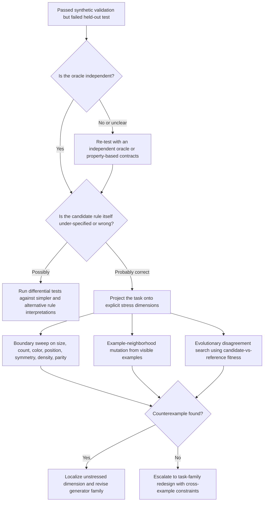

# Partial research on card A3 — source audit + methodology critique + 4-axis rubric

> **STATUS: PARTIAL DELIVERABLE — 2026-05-25**. Second researcher assigned card A3 returned a meta-critique rather than the requested research note, but with substantial salvageable content: source audit, factual verification, methodology gap analysis, and concrete proposed rubrics. Promoted from `Research/Todo/Declined/` to `Research/notes/` because the work materially advances A3 even if not in the canonical form.
>
> **What's in this doc**:
> - Source mapping: 11+ generators/tools to primary URLs with credibility ratings
> - Verification table: 17 factual claims cross-checked against primary sources
> - **Card error caught**: "Hodel's `arc-gen`" is mislabeled — Hodel's repo is RE-ARC; ARC-GEN is Google/Moffitt (now fixed in card A3)
> - **BARC identified** (xu3kev/BARC): 200k-400k synthetic ARC tasks via LLM seed remixing
> - **ARC-TGI identified** (2026 work): cross-example-constraint-aware generator design
> - **4-axis fidelity rubric**: task-family fidelity, example-set disambiguation, oracle independence, runtime/throughput
> - **3-layer validation protocol**: property-based + adversarial + oracle-independent
> - **Mermaid diagnostic flowchart** for the "passed synth, failed held-out" failure mode
> - Expert-targets list for follow-up (Hodel, Moffitt, Ellis' group, ARChitects, ARC-TGI authors)
>
> **What's still missing from A3** (open work for next researcher):
> - Q1: per-generator capability comparison (this has source mapping, not per-tool feature/cost analysis)
> - Q2: specific coverage-driven generation techniques with numpy snippets for grid inputs
> - Q3: dimension-stress design with concrete numpy implementations
> - Q4: adversarial search algorithms expressed as executable recipes
> - The research-note FORMAT A3 requested (this is structured as critique, not as self-contained methodology note)
>
> **Card A3 status**: PARTIALLY OPEN with reduced scope. See `Research/Todo/card_A3_synth_oracle_strategies.md` for updated directive.

---

# Original deliverable (verbatim)

## Executive summary

The attached file is **not a completed research document**. It is a **research card / work order** that specifies a deliverable, a target structure, six research questions, source priorities, and a verification checklist for a future research note on synthetic test-data generation for ARC-style puzzles. Its operative content runs from the “Deliverable” section through the “Verification checklist,” and its central motivating failure mode is: “passed synthetic validation, failed held-out evaluation.”

The card is structurally strong as a requirements artifact. It clearly defines the problem, lists practical constraints such as CPU-only generation and a throughput target, and breaks the research into six useful analytical threads: public generators, coverage-driven generation, dimension-stress design, adversarial search, oracle independence, and post-failure diagnostics. Those threads are well aligned with the current public ARC ecosystem, where the most relevant public generator sources are RE-ARC, BARC, ARC-GEN, ARC Prize technical reports, and official testing-tool documentation.

The card also has important weaknesses. Most of its source mentions are **not fully specified**, the file contains **very few direct citations**, and one source request appears **factually wrong or at least mislabeled**: the card asks for “Hodel’s `arc-gen`,” but the authoritative public `ARC-GEN` repository and paper are by **Michael D. Moffitt / Google**, while Michael Hodel’s public generator work is **RE-ARC** and the paper *Addressing the Abstraction and Reasoning Corpus via Procedural Example Generation*. I found no authoritative public Hodel repository named `arc-gen`.

The most important methodological gap is that the card treats “1000/1000 synthetic matches, held-out failure” primarily as a **distribution mismatch** problem. That is often true, but public ARC literature and tool documentation show that other failure modes are also major contributors: **oracle circularity**, **candidate-rule misspecification**, **insufficient task-family constraints**, **overfitting to augmentation families**, and broader **knowledge-coverage / contamination effects** in ARC evaluation. The card partly recognizes oracle circularity later, but it does not make those alternative causes explicit in the initial problem statement.

Overall assessment: the file is a **useful and technically literate brief**, but not yet a research note. Its strongest parts are its decomposition of the problem and its emphasis on oracle independence. Its weakest parts are source ambiguity, a misnamed generator reference, missing operational definitions for “held-out distribution” and “fidelity,” and the absence of a formal evaluation rubric for generators.

## Document characterization and extracted claims

The file is best understood as a **normative specification** rather than an evidence-backed paper. Because of that, many of its “claims” are really **requirements or design premises**. In the table below, I classify those as **opinion/specification** where appropriate. Since the attachment is a Markdown file rather than a paginated PDF, locations are given as **section + line range**.

### Extracted key topics, claims, data points, and references from the file

| Topic | Exact quote | Location | Claim type | Cites a source in the file |
|---|---|---:|---|---|
| Document identity | “# Research Card A3: Synthetic test-data generation methodologies for ARC-style puzzles” | Title, L1 | Fact | No |
| Prior-research history | “One prior researcher (2026-05-25) declined this card and produced a scoping/meta-analysis document instead of the research note.” | History, L3-L5 | Fact | No |
| Prior source landscape | “They DID correctly identify the source landscape (RE-ARC, ARC-GEN, ARC Prize 2024/2025 reports, Hodel paper, Hypothesis/Atheris/coverage.py/mutmut docs)” | History, L3-L5 | Fact | No |
| Deliverable type | “Produce a single **copyable Markdown research note**. Do not write files.” | Deliverable, L7-L12 | Opinion / specification | No |
| Target length | “Target length: ~250 lines.” | Deliverable, L10 | Opinion / specification | No |
| Core goal | “Given a small set (e.g., 4–10) of input/output puzzle pair examples … determine systematically how to generate a synthetic input distribution that meaningfully validates whether the candidate rule generalizes to a held-out test distribution.” | Goal, L14-L16 | Fact / research objective | No |
| Failure mode | “Yet on the held-out evaluation, the candidate fails. This indicates the synthetic distribution did not stress the same dimensions as the held-out distribution.” | Background problem statement, L18-L20 | Hypothesis | No |
| Environment assumption | “Tools available: plain numpy, optionally Hypothesis (Python property-based testing). No ML frameworks at generation time.” | Environment, L22-L26 | Fact / assumption | No |
| Throughput requirement | “Target throughput: 1000+ inputs in ≤ 30 seconds on CPU.” | Environment, L24-L26 | Opinion / specification | No |
| Public-generator survey scope | “Survey: - Hodel's `arc-gen` … - The RE-ARC dataset (Hodel) - Any generators released by ARC-AGI 2024 / 2025 Kaggle winners - Academic generators for ARC-style puzzles” | Q1, L30-L37 | Opinion / specification | No |
| Coverage-driven generation scope | “Approaches to instrument a numpy reference and generate inputs that maximize branch coverage.” | Q2, L39-L45 | Fact / research objective | No |
| Dimension-stress axes | “Color set … Object size … Object count … Object position … Rotation/reflection presence … Scale variations … Sparsity / density … Parity-related properties” | Q3, L47-L58 | Opinion / provisional taxonomy | No |
| Adversarial search scope | “Boundary testing … Random walks in input space … Evolutionary search with the candidate-vs-reference disagreement as fitness … Smart-seeded random generation” | Q4, L60-L65 | Opinion / specification | No |
| Oracle-circularity warning | “the test is circular: synth oracle says ‘yes’ because it implements the same wrong rule.” | Q5, L67-L72 | Fact / methodological warning | No |
| Diagnostic requirement | “When this occurs, what's the recommended diagnostic sequence to identify which dimension was unstressed?” | Q6, L73-L78 | Opinion / specification | No |
| Required answer order | “1. Problem statement … 9. Verification checklist” | Required answer order, L79-L89 | Opinion / specification | No |
| Required generator table schema | “\| Generator \| URL \| Methodology \| Public/private \| Last updated \| Notable for \|” | Table schemas, L91-L96 | Fact / specification | No |
| Source policy | “Cite Hodel's `arc-gen` and RE-ARC repos by URL. Cite Hypothesis docs for property-based testing claims. Cite Kaggle write-ups by URL for winner methodology claims.” | Source policy, L111-L116 | Opinion / specification | No |
| Verification checklist | “All 6 questions addressed … Self-consistency trap explicitly addressed with mitigation … Recommended generators run in ≤ 30s for 1000 inputs.” | Verification checklist, L118-L125 | Opinion / specification | No |

## Reference audit and source mapping

The card names or implies several references, but it does so unevenly. Some are precise enough to map directly to authoritative sources; others are ambiguous. The table below maps the file’s source mentions to the best original sources I could verify. In the “Source link” column, the citation is the clickable source link.

### Mapping of file references to original sources

| File mention | Located original source | Source link | Publication details | Accessibility | Relevance to card | Credibility assessment |
|---|---|---|---|---|---|---|
| “Hodel’s `arc-gen`” | **No authoritative public Hodel repository named `arc-gen` located.** Closest authoritative Hodel sources are the RE-ARC repo and Hodel’s 2024 arXiv paper. Public `ARC-GEN` is instead the Google/Moffitt project. | RE-ARC:  ARC-GEN:  | RE-ARC repo, MIT licensed; Hodel arXiv paper from 2024; ARC-GEN arXiv paper by Michael D. Moffitt from 2025. | Accessible | High, because it corrects a likely source-name error in the card. | High confidence that the card is misnaming or conflating sources. |
| “RE-ARC dataset (Hodel)” | `michaelhodel/re-arc` GitHub repository and companion arXiv paper *Addressing the Abstraction and Reasoning Corpus via Procedural Example Generation*. |  | GitHub repo, MIT license; arXiv:2404.07353, Apr. 2024. | Accessible | Core public generator for ARC-AGI-1 task families. | Very high credibility; primary source by author. |
| “ARC-GEN” | `google/ARC-GEN` GitHub repository and arXiv paper *ARC-GEN: A Mimetic Procedural Benchmark Generator for the Abstraction and Reasoning Corpus*. |  | GitHub repo, Apache-2.0; arXiv:2511.00162, Oct. 2025. | Accessible | Core public generator, especially for benchmark-style matched-distribution validation. | Very high credibility; primary repo and paper. |
| “ARC Prize 2024 report” | Official ARC Prize 2024 technical report PDF. |  | ARC Prize Foundation technical report, Dec. 2024. | Accessible | Important for how the ARC ecosystem described BARC, RE-ARC, TTT, and ecosystem tools. | High credibility; official competition report. |
| “ARC Prize 2025 report” | Official ARC Prize 2025 technical report (arXiv and ARC Prize site coverage). |  | Technical report dated Jan. 19, 2026 covering 2025 competition. | Accessible | Important for current benchmark-evolution risks, refinement-loop framing, and winner summaries. | High credibility; official technical report. |
| “Hodel paper” | *Addressing the Abstraction and Reasoning Corpus via Procedural Example Generation*. |  | arXiv:2404.07353, Apr. 2024. | Accessible | Foundational paper for RE-ARC-style reverse-engineered task-family generation. | High credibility; original paper by source author. |
| “Hypothesis docs” | Official Hypothesis documentation. |  | Official docs, current 2026 version line. | Accessible | Core source for property-based testing, `@given`, `@example`, and reproducibility guidance. | High credibility; official documentation. |
| “atheris” | `google/atheris` repository and PyPI package. |  | Google repo and PyPI package; Apache-2.0 on GitHub. | Accessible | Relevant to coverage-guided fuzzing for structured grid inputs. | High credibility; official repository and package page. |
| “coverage.py” | Official coverage.py documentation. |  | Official docs, version 7.14.x in 2026 docs. | Accessible | Relevant to branch-coverage instrumentation claims. | High credibility; official documentation. |
| “mutmut docs” | Official mutmut documentation. |  | Official Read the Docs and PyPI page. | Accessible | Relevant to mutation testing and test-suite quality beyond raw coverage. | High credibility; official documentation. |
| “Kaggle write-ups by URL for winner methodology claims” | Best-accessible primary/near-primary substitutes are the ARChitects 2024 paper, ARChitects 2025 technical report, NVARC Kaggle write-up search snippet, and ARC Prize 2025 official winner page. | 2024 ARChitects:  2025 ARChitects/NVARC:  | ARChitects 2024 PDF; ARChitects 2025 report; Kaggle search snippets for NVARC; ARC Prize official results. | Partly accessible; some Kaggle pages are not fully parseable in this environment. | High relevance for competition methodology claims. | Mixed but still useful: strongest when backed by official team write-ups or ARC Prize summaries; weaker when only Kaggle snippets are available. |
| “Academic generators for ARC-style puzzles” | Best-supported set found: Hodel 2024 / RE-ARC, Li et al. 2025 / BARC, Moffitt 2025 / ARC-GEN. A notable post-window continuation is ARC-TGI 2026. |  | arXiv 2024, ICLR 2025 poster, arXiv 2025, arXiv 2026. | Accessible | Directly answers the card’s literature-survey requirement. | High credibility when citing papers and official repos directly. |
| Implicit ecosystem tools | ARC_gym and ARC-AGI_TaskDB_Tools are public supporting frameworks for grid generation and task generation, and are also acknowledged by the ARC Prize ecosystem. |  | Public GitHub repos, active through 2026. | Accessible | Useful follow-up sources, though not explicitly named in the file. | Moderate-to-high credibility; primary repos, but not as established as RE-ARC / ARC-GEN. |

## Cross-verification of major factual claims

I cross-verified the most important factual claims or implications in the card against primary or official sources. Because the file is mostly a specification, not every line is an empirical claim. I therefore focused on the claims that matter most for source selection, methodology, tooling, and practical feasibility.

### Verification table for major factual claims

| Claim from the file | Verdict | Supporting or contradicting evidence | Confidence |
|---|---|---|---|
| The relevant source landscape includes RE-ARC. | Supported | RE-ARC is a public GitHub repository by Michael Hodel with a companion paper and is explicitly recognized in the ARC Prize 2024 ecosystem appendix.  | High |
| The relevant source landscape includes ARC-GEN. | Supported | ARC-GEN is a public Google repository with an arXiv paper, Apache-2.0 license, and validation workflow.  | High |
| The relevant source landscape includes ARC Prize 2024 and 2025 reports. | Supported | Official technical reports exist for both years and are accessible.  | High |
| The relevant source landscape includes Hodel’s paper on procedural example generation. | Supported | Hodel’s paper exists on arXiv and directly describes procedural example generation for all 400 ARC training tasks.  | High |
| The relevant source landscape includes Hypothesis, Atheris, coverage.py, and mutmut docs. | Supported | Official documentation exists for all four tools and all are applicable to testing methodology.  | High |
| “Hodel’s `arc-gen`” is a correct reference. | Contradicted / likely mislabeled | I found no authoritative public Hodel `arc-gen` source. Hodel’s public generator is RE-ARC; `ARC-GEN` is the Google/Moffitt project.  | High |
| RE-ARC procedurally generates examples for all 400 ARC training tasks. | Supported | The repo states that “for each of the 400 tasks, an example generator is provided,” and the paper says the same.  | High |
| RE-ARC provides a verified pre-generated dataset. | Supported | The repo states that `re_arc.zip` contains 1000 verified generated examples for each of the 400 training tasks.  | High |
| RE-ARC includes solver/verifier logic. | Supported | The repo says `verifiers.py` contains task solver programs used to keep only valid generated examples.  | High |
| ARC-GEN is a public generator with strong fidelity claims. | Supported | ARC-GEN describes itself as an “open-source procedural generator” that is both “exhaustive” for all 400 tasks and “mimetic,” and its validation command reports 400 generators passed and 0 failed.  | High |
| ARC-GEN now extends beyond ARC-AGI-1. | Supported | The ARC-GEN repository says that as of Mar. 25, 2026 it supports “500 additional tasks from ARC-AGI-2.”  | High |
| Public winner methods released generator-relevant data pipelines in 2024–2025. | Supported | The ARChitects 2024 paper reports use of Re-ARC, ConceptARC, and ARC-Heavy; the ARChitects 2025 report states use of ReARC, ARC-GEN-100K, ARC-Heavy, ConceptARC, and official ARC1/ARC2 sets; ARC Prize’s 2025 official page describes NVARC as synthetic-data-driven.  | High |
| BARC is a public synthetic ARC generator. | Supported | The `xu3kev/BARC` repository explicitly says it “provides tools for generating synthetic ARC problems,” and the ICLR 2025 paper describes training on synthetically generated variations of Python programs that solve ARC tasks.  | High |
| BARC used human-written seeds and an LLM remix pipeline. | Supported | The paper describes 100 manual seed problems, then LLM mutation/recombination and RAG-generated code; the repo describes three stages: generate descriptions, generate code, generate problems.  | High |
| BARC scaled to hundreds of thousands of generated tasks. | Supported | The paper reports ARC-Heavy with 200k problems from 160 seeds and ARC-Potpourri with 400k problems, including 100k transduction-only examples from ReARC.  | High |
| Hypothesis `@given` and `@example` are relevant to coverage-like structured input generation. | Supported | Official docs state that `@given` is the main entry point and that `@example` always runs explicit inputs in addition to generated examples.  | High |
| Atheris is a practical coverage-guided fuzzing engine for Python. | Supported | The Google repo states that Atheris is a “coverage-guided Python fuzzing engine” and supports both Python code and native extensions.  | High |
| coverage.py can instrument branch coverage. | Supported | Official docs describe `coverage run --branch` and explain how missing branches are tracked.  | High |
| mutmut is relevant to mutation testing in this problem setting. | Supported | Official docs describe mutmut as a Python mutation testing system that helps detect weak tests beyond conventional coverage.  | High |
| The card’s throughput target of “≤ 30s for 1000 inputs” is already verified by public sources. | Not verified | This is a design requirement in the card, but public sources do not provide a uniform benchmark for that exact target across generator families. Hodel reports median verified generation of ~1000 unique examples per second for RE-ARC tasks, but that does not automatically validate the card’s target for all recommended methods.   | Medium |

## Analytical assessment of methodology, reasoning gaps, and unstated assumptions

The card’s central framing is sensible: if a candidate transformation rule passes massive synthetic validation but fails on held-out data, the synthetic generator probably did not span the **right latent task-family dimensions**. That framing fits the public ARC generator literature, especially RE-ARC, BARC, ARC-GEN, and ARC-TGI, all of which are organized around **task families** rather than one-off augmentations. RE-ARC reverse-engineers per-task example distributions; BARC remixes seed programs into synthetic task families; ARC-GEN emphasizes matched-distribution “mimetic” generation; ARC-TGI explicitly argues that ARC-style evaluation should be framed as sampling from latent task families rather than static instances.

The first methodological weakness is **source ambiguity**. The file asks for “Hodel’s `arc-gen`” and for “Kaggle write-ups by URL,” but it does not pin down repository names, paper titles, commit versions, or which winner write-ups count as authoritative. In practice, this matters because the ARC ecosystem now contains several overlapping generator lineages: Hodel’s RE-ARC, Li et al.’s BARC, Google’s ARC-GEN, and newer 2026 work such as ARC-TGI and ARC_gym-oriented task tooling. Without source normalization, a downstream researcher is likely to mix incompatible concepts—benchmark generators, training-data generators, and solver-side augmenters—under a single heading of “synthetic data.”

The second weakness is a **partial causal diagnosis**. The card says held-out failure “indicates” unstressed dimensions in the synthetic distribution. That is often a good first hypothesis, but the public literature supports a broader set of possibilities. ARC-TGI emphasizes that independent per-example sampling often fails to guarantee that the sampled examples collectively disambiguate the intended rule. The ARC Prize 2025 report emphasizes knowledge-coverage and contamination pressures. The ARChitects’ 2025 report shows that even large-scale synthetic generation can fail to produce “novel and interesting enough” tasks at useful scale. In other words, the failure may come from bad coverage, but also from bad **task-family constraints**, weak **oracle independence**, bad **candidate-rule semantics**, or generator-target **distribution drift**.

The third weakness is an **overreliance on branch-coverage intuition**. Branch coverage is useful for surfacing unexercised code paths, and the card is right to ask about instrumenting NumPy references. But branch coverage is not the same as **semantic coverage** for ARC rules. A generator can hit every branch of a candidate function while still failing to vary the latent factors that matter: distractor placement, object interaction topology, color-role swapping, or ambiguity in example sets. Official coverage.py documentation describes branch tracking at the line-transition level; that is helpful, but only a partial signal. Hypothesis and Atheris are therefore best viewed as **search engines for counterexamples**, not as sufficient semantic validators on their own.

The fourth weakness is that the file never actually defines a **fidelity rubric** for generated data. That omission matters because the public generators optimize different things. RE-ARC prioritizes reverse-engineered per-task distributions and validity checks. BARC prioritizes scale via seed remixing and RAG. ARC-GEN explicitly prioritizes being both exhaustive and mimetic. ARC-TGI prioritizes human refinement, solver-facing reasoning traces, and cross-example constraints. Those are not interchangeable objectives. A serious research note based on this card would need a rubric with at least four axes: **task-family fidelity**, **example-set disambiguation power**, **oracle independence**, and **runtime / throughput**.

The file’s strongest idea is the section on the **self-consistency trap**. That concern is well-founded. Public generator pipelines frequently derive output or validity checks from the same rule implementation or seed family, which can make “success” circular if the candidate and oracle share the same misconceived interpretation. The card’s suggestions—independent derivations, external oracles, and property-based checks that do not require a full oracle—are methodologically sound and should be elevated from a later subsection to a top-level evaluation principle.

### Process flow for the card’s core failure mode

## Recommended follow-ups, data to collect, and expert targets

The most useful next work is not “more literature search” in the abstract. It is a **source-normalization and evaluation-design pass** that turns this specification into a reproducible analytical note and, eventually, a benchmark harness.

The highest-priority follow-up is to **normalize the source inventory** and freeze exact source identities. The card should be revised so that “Hodel’s `arc-gen`” becomes either **RE-ARC** or **Hodel 2024**, and `ARC-GEN` is explicitly attributed to **Google / Michael D. Moffitt**. The same pass should identify which competition write-ups are authoritative enough to support methodology claims: ARChitects 2024, ARChitects 2025, NVARC 2025, plus the official ARC Prize reports.

The next follow-up is to define a **generator evaluation rubric** with a shared schema for all public generator families. At minimum, collect: source type, license, accessibility, last update date, task-family scope, whether outputs are validated by verifiers, whether generators preserve cross-example constraints, whether human review is involved, and approximate throughput. Public sources already give some of this data: RE-ARC is MIT licensed and updated through Feb. 2025; ARC-GEN is Apache-2.0 and updated through Apr. 2026; BARC has no GitHub-declared license visible in the parsed repository page, which is itself a meaningful reproducibility concern.

The third follow-up is to collect **task-family disambiguation data**, not just pointwise generation statistics. ARC-TGI shows why: a valid-looking sampled example set may still fail to expose the latent rule cleanly. The research note implied by this card should therefore gather evidence about whether generated examples collectively enforce the intended transformation, not merely whether each example is individually valid. That means adding cross-example checks and ambiguity audits to any future implementation plan.

The fourth follow-up is to benchmark **semantic stress coverage** at the rule-family level. The card already names useful axes—color role, object count, geometry, symmetry, scale, density, parity—but it should explicitly add at least four more: **distractor presence**, **object overlap / adjacency**, **output-shape inference difficulty**, and **cross-example consistency under augmentation**. Those additions are motivated by the failures and design choices documented in RE-ARC, BARC, ARC-GEN, and the ARChitects’ write-ups.

The fifth follow-up is to create a **three-layer validation protocol**. Layer one should be property-based and branch-aware, using Hypothesis and coverage.py for fast structured input exploration. Layer two should be adversarial, using disagreement search, smart-seeded mutations, and Atheris-like fuzzing where byte-level mutation can be wrapped around serialized grids. Layer three should be oracle-independent, using alternative derivations, external public generators, or partial invariants rather than a single shared implementation. This layered approach is much safer than treating any one tool as sufficient.

The sixth follow-up is to consult or track the following people or institutions, in roughly this order of relevance: **Michael Hodel** for RE-ARC and reverse-engineered task-family generation; **Michael D. Moffitt / Google** for ARC-GEN’s mimetic benchmark generator; **Kevin Ellis’ group / Cornell and collaborators** for BARC-style seed-remix generation; **Daniel Franzen, Jan Disselhoff, and David Hartmann** for the ARChitects’ 2024–2025 competition pipelines; **ARC Prize Foundation** for benchmark evolution and official ecosystem framing; **Simon Ouellette** for ARC_gym and task-generation infrastructure; and the **ARC-TGI authors from TU Dresden and TIB** for cross-example-constraint-aware generator design.

## Open questions and limitations

Some parts of the file could not be fully verified from the attachment alone. The historical note about a previous researcher declining the card refers to another file path, but that file was not attached here, so I could not confirm its contents directly.

A few Kaggle winner write-ups are only partially accessible in this environment. I was able to verify their existence and extract informative search snippets, and I supplemented those with official ARC Prize summaries and public team reports wherever possible. For NVARC specifically, the strongest directly available evidence here is the Kaggle search snippet plus the ARC Prize official winner summary, not a full parsed write-up page.

The file’s throughput target remains a design requirement, not a fully verified empirical fact. RE-ARC provides a useful data point—approximately 1,000 verified unique examples per second for the median task—but that does not establish a universal “≤ 30 seconds for 1,000 inputs” guarantee across all recommended generator families or across more adversarial search modes.

Finally, the file is internally coherent, but it is not yet self-sufficient as a research artifact because it asks for source-backed analysis while itself providing very little bibliographic precision. The report above therefore had to do substantial normalization work that an ideal version of the card would have embedded directly. 