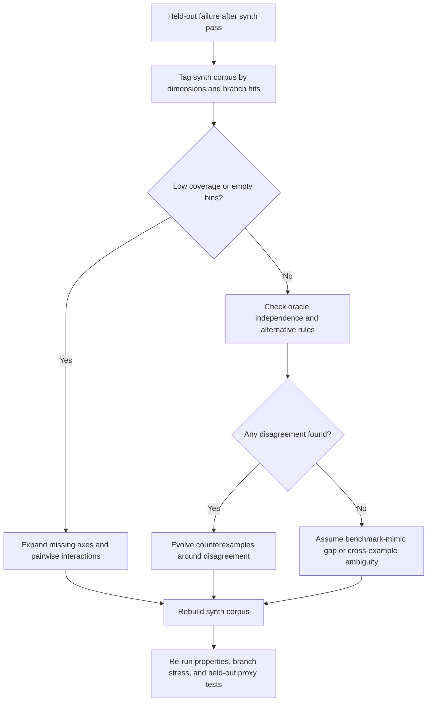

# Synthetic Oracle Strategies for ARC-Style Puzzle Validation

> **STATUS: Card A3 deliverable, researcher #3, 2026-05-25T17:43Z; distilled 2026-06-10 (refactor pass 4).** Live keeps the load-bearing core: 4-axis fidelity rubric, self-consistency trap + mitigation, generator comparison, evolutionary disagreement search, failure diagnostic. Survey prose, coverage/dimension-stress recipes (snippets S2/S3/S4/S6), decision matrix, methodology, and the verbatim A3 assignment card: `_archive/synth_oracle_strategies_evicted_2026-06-10.md`. Full original: `_archive/synth_oracle_strategies_pre_refactor_2026-06-10.md`. Researcher-#2 partial audit: `_archive/notes_synth_oracle_partial_audit_2026-05-25.md`.

## The failure mode: 4-axis fidelity rubric

"Passed synth, failed test" — 1000/1000 matches on synthetic inputs, then a held-out failure — is a **distribution mismatch** across at least one of four fidelity axes:

1. **Rule fidelity** — synthetic samples really preserve the same latent transformation.
2. **Dimension coverage** — all causally relevant axes are stressed, including the four often-forgotten ones: distractor presence, object overlap/adjacency, output-shape inference difficulty, cross-example consistency under augmentation.
3. **Distribution realism** — sizes/layouts/object statistics resemble the intended held-out distribution.
4. **Oracle independence** — the pass/fail test is not merely echoing the same mistaken interpretation as the candidate.

Scale calibration: the 2024 ARChitects system posted ~53.5% on ARC-AGI-1 but only ~2.5–3% on ARC-AGI-2 — exactly what a benchmark-mismatch failure looks like. ARC-TGI's core argument applies at task scale too: independently sampled per-example inputs often fail to expose the underlying rule, so for some families the unit of stress is the **joint train set**, not a single grid.

## The self-consistency trap (load-bearing)

The self-consistency trap is real: if the candidate rule and the synthetic oracle are both derived from the same mistaken interpretation, "1000/1000 matches" is nearly meaningless. **Never validate a candidate against an oracle derived from the candidate.** The most reliable mitigation is to require **three independent semantic lenses** before trusting the result. First, use at least one **independent implementation** or public verifier whenever possible; RE-ARC and ARC-GEN are especially useful here because both expose explicit generators and validation logic, and RE-ARC additionally exposes corresponding solver/verifier programs. Second, add a **property bundle** that does not require full output equality, such as color-subset constraints, count-preservation bounds, equivariance under recoloring bijections, or monotonicity/containment constraints. Third, run **mutation testing** on those properties and helpers; if obvious mutants survive, the property bundle is too weak to serve as an independent oracle layer.

The cleanest practical three-layer validation protocol is therefore: **Layer one**, structural validity and branch diversity; **layer two**, semantic checks from an external/public implementation plus metamorphic or invariant properties; **layer three**, adversarial disagreement search against alternative interpretations.

A strong property bundle for ARC-like grids usually includes at least one property from each of these families: **shape constraints** such as "output dims remain within 1..30"; **palette constraints** such as "output colors are a subset of input colors plus the known marker color set"; **object constraints** such as "the number of selected objects in output equals the number of target objects in input"; and **symmetry/metamorphic constraints** such as "relabeling colors by a bijection relabels the output correspondingly" when the task is color-agnostic. Those are not universal truths; they are **task-family-specific auxiliary oracles**. Their job is not to solve the puzzle in full, but to make it harder for a wrong shared interpretation to pass.

## Public generator comparison

| Generator | URL | Methodology | Public/private | Last updated | Notable for |
|---|---|---|---|---|---|
| RE-ARC | GitHub repo / arXiv note | Reverse-engineered, per-task procedural generators plus solver verifiers; ships verified examples for all 400 ARC-AGI-1 training tasks | Public | 2025-02-24 | Lowest-friction high-fidelity sampling for the original 400 train tasks |
| ARC-GEN | GitHub repo / arXiv paper | Mimetic procedural benchmark generator; validates against all 400 ARC-AGI-1 tasks and exposes static 100K benchmark suite | Public | 2026-04-18 | Best benchmark-mimetic public generator; ARC-AGI-2 support added |
| BARC | GitHub repo / paper / HF datasets | LLM seed-remix pipeline from manually written seed tasks: descriptions → code → concrete problems; supports induction/transduction training | Public repo | 2024-11-20 | Large synthetic corpora and seed-remix diversity |
| ARC-TGI | GitHub repo / arXiv paper | Human-validated task-family generators with reasoning templates, partially evaluated code, and task-level constraints across examples | Public | 2026-02-16 | Best public design for cross-example consistency |
| ARChitects synthetic stack | Public technical reports | ARC-specific augmentations, TTT, and limited hand-curated synthetic tasks; not a released standalone generator package | Mixed | 2025 report page | Important cautionary case: useful augmentation, weak standalone generator yield |
| NVARC synthetic pipeline | GitHub repo / official ARC Prize summary | Multistage SDG pipeline plus improved ARChitects-style TTT and TRM components; released synthetic and augmented puzzle datasets | Public repo | 2025-11-15 | Winner-grade synthetic-data pipeline, high augmentation scale |
| AugARC | GitHub repo / workshop paper | Rotation-based augmentation benchmark tailored to LLM textual encodings | Public | 2025-03-31 | Low-cost augmentation, but mostly presentation-level variation |

One-line facts that matter when choosing:
- **RE-ARC** (`michaelhodel/re-arc`, MIT): generators + solver-verifiers for each of the 400 ARC-AGI-1 train tasks; 1000 verified examples per task.
- **ARC-GEN** (`google/ARC-GEN`, Apache-2.0; Moffitt, NOT Hodel — "Hodel ARC-GEN" was a card error): `validate` passes all 400 ARC-AGI-1 generators; 500 ARC-AGI-2 tasks added 2026-03-25.
- **ARC-TGI** (Apache-2.0): 461 human-refined generators (180 ARC-Mini / 215 ARC-AGI-1 / 66 ARC-AGI-2); task-level cross-example constraints are first-class — best public design against joint-train-set ambiguity.
- **BARC** (`xu3kev/BARC`, no declared license): 162 seed solutions remixed via LLM pipeline; 200k "heavy" + several 100k datasets on HF (the 400k Potpourri figure is secondary-source only).
- **NVARC**: released 103k synthetic + 3.2M augmented puzzles; winner-grade SDG pipeline.
- **ARChitects** (cautionary): their synthetic-generation effort did not scale — only ~1 in 50–100 generations was novel/useful; a curated 150-task set was not worth the effort.

## Adversarial search: evolutionary disagreement mining

The single most important adversarial tool. Fitness must combine at least four signals: **candidate/reference disagreement**, **branch-hit novelty**, **boundary bonus**, and **distance from already-seen bins**. If the reference oracle is untrusted, replace the disagreement term with candidate-vs-**alternative-interpretation set** or candidate-vs-**property bundle**. Seed from the visible examples (or RE-ARC/ARC-GEN samples) and mutate with small semantics-relevant edits: add/remove a distractor, move an object center→edge, resize a selected object by one cell, replace one color, pad the border, transpose rectangular grids, create ambiguous near-ties.

**Snippet S5 — mutation-plus-disagreement evolutionary search**

```python
def evolve(seed_bank, mutate, branch_hits, alt_oracle, steps=100, keep=32):
    covered = set()
    pop = list(seed_bank)
    for _ in range(steps):
        cand = [mutate(g) for g in pop for _ in range(4)]
        def score(g):
            disagree = int(not np.array_equal(candidate(g), alt_oracle(g)))
            hits = branch_hits(g)
            boundary = int(g.shape[0] in {1, 30} or g.shape[1] in {1, 30})
            return disagree + len(hits - covered) + boundary
        pop = sorted(cand, key=score, reverse=True)[:keep]
        for g in pop:
            covered |= branch_hits(g)
    return pop
```

**Snippet S1 — manual branch-hit instrumentation with greedy corpus selection** (the cheap coverage proxy: tag semantic branch families inside the oracle with `hits.add("tag")`; use coverage.py branch mode only intermittently to calibrate the tags, never in the hot loop)

```python
import numpy as np

def collect_covering_corpus(random_grid, oracle, budget=5000, target_n=1000):
    covered, corpus = set(), []
    for _ in range(budget):
        g = random_grid()
        hits = set()
        _ = oracle(g, hits)          # oracle calls hits.add("shape=thin"), etc.
        if hits - covered:
            covered |= hits
            corpus.append(g)
        if len(corpus) >= target_n:
            break
    return corpus, covered
```

Tool one-liners: Hypothesis = bias dimensions to `sampled_from([1,2,3,5,10,15,30])`, seed with `@example`, drive `target()` on density/object-count/branch-novelty, and let shrinking minimize the failures evolution finds. Atheris pays off only after a grid serializer + custom structure-preserving mutator exist. mutmut's role is hardening the **oracle bundle** (mutate the property checks; obvious mutants surviving = oracle too weak), not generating grids; on Windows it needs WSL.

## Diagnostic: "passed synth, failed test"

Store every synthetic sample with metadata (rule family, shape bin, palette bin, object-count bin, branch-hit set, mutation provenance) — then diagnosis is **tag → slice → compare → mine → rebuild → retest**:

1. Map the held-out failure to a candidate rule family.
2. Bisect the synth corpus by stored dimension/branch tags, not random halves.
3. Differential-test against a small library of **simpler alternative interpretations** that also fit the visible examples.
4. Run disagreement-guided evolutionary search on the highest-risk bins.
5. Mutate the property bundle / auxiliary validators to check oracle independence.
6. Promote every discovered failure into a mandatory generator bin or cross-example constraint; rebuild the local benchmark.



| Symptom | First hypothesis | Test to perform | Next step |
|---|---|---|---|
| Fails only on larger or smaller outputs | Output-shape inference was unstressed | Slice by output-shape bins; rerun shape-anchor sweep | Add mandatory shape bins and shape-conditioned train sets |
| Fails when extra clutter is present | Distractor robustness missing | Inject irrelevant colors/objects into passing cases | Make distractor presence a required axis |
| Fails only when multiple examples are considered jointly | Cross-example ambiguity | Resample train examples jointly and compare against simpler rules | Adopt ARC-TGI-style episode constraints |
| Candidate and oracle always agree, but simpler rule also fits | Oracle circularity | Differential test versus independent implementation and property mutants | Strengthen oracle bundle before trusting synth pass rates |
| Branch coverage looks saturated, but held-out still fails | Benchmark-mimic gap | Compare synthetic dimension histograms to ARC-GEN / public family stats | Replace or rebalance family generator toward mimetic support |

---
*Evicted 2026-06-10 (refactor pass 4): executive summary, attachment-scope notes, generator survey prose, coverage-driven + dimension-stress sections (snippets S2/S3/S4/S6), adversarial prose, decision matrix, methodology/assumptions, and the verbatim A3 assignment card → `_archive/synth_oracle_strategies_evicted_2026-06-10.md` (pre-refactor snapshot: `_archive/synth_oracle_strategies_pre_refactor_2026-06-10.md`).*
